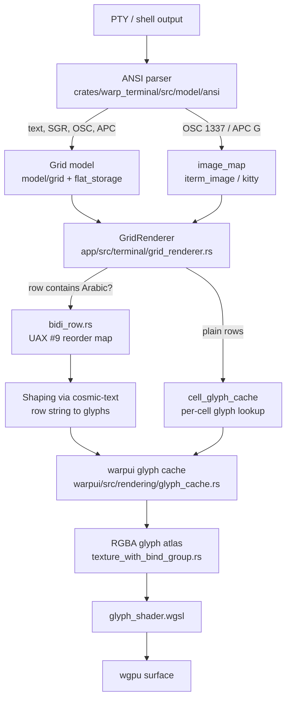
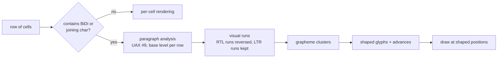
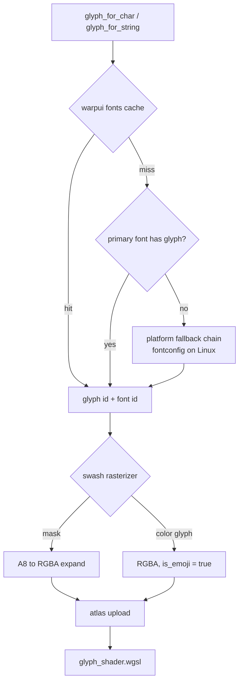

# Architecture

This document describes the implementation that exists in this repository. It is
written from the source, not from upstream design documents, and it names the
files and functions that carry each responsibility.

- Repository: <https://github.com/AlMagrhibi/warp-arabic-rtl>
- Upstream: <https://github.com/warpdotdev/warp> (AGPL-3.0 / MIT)
- Branch described: `arabic-bidi`
- Released baseline: `v1.0.0`, see `RELEASE-NOTES-v1.0.0.md`

## 1. What this fork changes

Upstream Warp renders terminal text strictly left to right, cell by cell, with
each cell holding one glyph. Arabic therefore appears disconnected and in reverse
order.

This fork adds one capability on top of upstream, and keeps everything else
stock:

| Change | File | Effect |
| --- | --- | --- |
| Row-level BiDi analysis | `app/src/terminal/bidi_row.rs` | Detects rows that contain BiDi or joining characters (`row_needs_bidi`), runs the Unicode Bidirectional Algorithm over the row (`analyze_row`), and produces a reorder map (`reorder_map`) |
| Whole-row shaping and drawing | `app/src/terminal/grid_renderer.rs` (`grid_rows_need_bidi_rendering`) | Rows that need BiDi are shaped as one string and drawn from glyph positions instead of per-cell glyph snapping; other rows keep the original cell-based path |

Everything else in the pipeline — PTY handling, the grid model, escape-sequence
parsing, image protocols, the glyph atlas, and the GPU renderer — is upstream
code.

## 2. Crates

| Crate | Responsibility |
| --- | --- |
| `app` (`warp`) | Application shell, terminal views, grid renderer, settings, blocks, AI panel |
| `crates/warp_terminal` | Headless terminal model: ANSI/OSC/APC parsing, grid storage, cells, graphemes, image maps |
| `crates/warpui_core` | Platform-independent UI core: fonts API, scene graph, platform traits |
| `crates/warpui` | Window creation, font loading, glyph rasterization and caching, wgpu/Metal renderers, text layout |
| `crates/warp_features` | Compile-time feature flags (`FeatureFlag::*`) |
| `crates/warp_assets` | Embedded assets (`app/assets`, `bundled/**`), including bundled fonts |

## 3. Data flow

Two rendering paths coexist by design:

- **Cell path (upstream).** For every visible cell the renderer looks up the glyph
  for the character (`CellGlyphCache::glyph_for_char`), rasterizes it on demand,
  snaps it to its cell column, and paints it. This keeps monospace geometry exact.
- **BiDi path (this fork).** When `grid_rows_need_bidi_rendering` reports that a
  row needs BiDi, the row's text is laid out once, so the shaper can join Arabic
  letters and reorder runs, and the renderer paints glyphs at the positions the
  shaper computed (`glyph.position_along_baseline`). Cursor and selection still
  address logical cells.

## 4. Unicode handling

`bidi_row.rs` exposes four items that the renderer uses:

- `is_bidi_or_joining_char` — per-character test used to skip the expensive path.
- `row_needs_bidi` — fast whole-row test.
- `analyze_row(cells) -> Option<BidiRowLayout>` — runs UAX #9, returns paragraph
  level, runs, and the reorder map.
- `reorder_map` — logical column to visual position mapping used when drawing.

Clipboard and selection always work on logical cell ranges, so copied text is the
original Unicode string, not the visual order.

## 5. Fonts and glyphs

- Font families are inserted at startup: bundled Hack (monospace), bundled Roboto
  (UI), the password font, and optionally a bundled color emoji family
  (`app/src/appearance.rs`).
- Fallback lookup happens per character in
  `crates/warpui/src/windowing/winit/fonts.rs`; the platform returns an ordered
  list of candidate fonts and the first one that maps the character wins.
- Rasterization uses swash (`crates/warpui/src/windowing/winit/fonts/swash_rasterizer.rs`).
  The atlas texture is `Rgba8Unorm` (`texture_with_bind_group.rs`).
- `RasterizedGlyph::is_emoji` tells the shader whether to use the sampled color
  (emoji) or the terminal foreground color (text). `glyph_shader.wgsl` mixes on
  that flag.

### Color emoji status

A feature branch `feature/color-emoji` bundles Twemoji Mozilla (COLR/CPAL v0) and
prefers it for emoji code points, with unit tests for classification, fallback
ordering, and emoji cluster joining. GUI verification has **not** passed: emoji
cells are not painted in the terminal grid in that build, so the branch is not
merged and the released AppImage still renders emoji from whatever monochrome
symbol font fontconfig ranks first. This section will be updated when the branch
passes the screenshot gate.

## 6. Inline image protocols

See `docs/IMAGE-PROTOCOLS.md` for the verified matrix. In short:

- Kitty graphics: APC `ESC_G`, parsed by `crates/warp_terminal/src/model/kitty.rs`,
  stored in `image_map.rs`, drawn by the grid renderer. Verified working with a
  PNG payload on the released AppImage.
- iTerm2: OSC 1337 `File=`, parsed by `iterm_image.rs`. Verified working.

Both are upstream code paths, gated by the `kitty_images` compile-time feature and
`FeatureFlag::KittyImages`.

## 7. Settings and feature flags

- Settings are the upstream Warp settings model; this fork adds no keys of its
  own.
- Behaviour that upstream gates at compile time uses the same `FeatureFlag`
  machinery (`crates/warp_features/src/lib.rs`, `app/src/features.rs`).
- The BiDi renderer added by this fork is **always on**; there is no flag that can
  turn it off, which keeps the published artifact's behaviour predictable.

## 8. Packaging

```mermaid
flowchart LR
    SRC[source] --> CARGO[cargo build<br/>profile release-lto]
    CARGO --> BIN[target/release-lto/warp-oss]
    BIN --> BUNDLE[script/bundle -c oss --packages appimage]
    BUNDLE --> APPIMAGE[WarpOss-x86_64.AppImage]
    APPIMAGE --> CHECK[sha256 + isolated-HOME launch test]
    CHECK --> RELEASE[GitHub release asset]
    RELEASE --> INSTALL[scripts/install.sh<br/>rootless, per-user]
    INSTALL --> KDE[desktop entry + icons<br/>StartupWMClass=dev.warp.WarpOss]
```

- `script/linux/bundle` needs `SETTINGS_SCHEMA_EXECUTABLE` (or
  `SETTINGS_SCHEMA_SOURCE`) when called with `--skip-build`, `NO_LICENSES=1` to
  skip `cargo about`, and `NO_STRIP=1` to avoid the `.relr.dyn` strip failure.
- The AppImage contains the modified `warp-oss` binary at
  `opt/warpdotdev/warp-terminal-oss/warp-oss`; `scripts/install.sh` extracts just
  that file to prove it is the Arabic build before installing.
- The window reports `WM_CLASS = dev.warp.WarpOss`. The installed desktop entry
  uses `StartupWMClass=dev.warp.WarpOss` so KDE binds the window to the launcher
  and uses the project icon.

## 9. Update isolation

Upstream auto-update is not compiled into this build: the OSS channel bails out in
`app/src/autoupdate/mod.rs`, and `FeatureFlag::Autoupdate` is behind
`#[cfg(feature = "autoupdate")]`, which is not part of `release_bundle`. Releases
of this fork are installed and updated by hand from this repository only. See
`docs/UPDATE-POLICY.md`.

## 10. Testing

| Layer | Command | Status |
| --- | --- | --- |
| BiDi row analysis | `cargo test -p warp --lib terminal::bidi_row` | 5 passed (v1.0.0) |
| Grid renderer | `cargo test -p warp --lib terminal::grid_renderer` | 15 passed, 1 ignored (v1.0.0) |
| Emoji classification (branch) | `cargo test -p warpui_core fonts::emoji` | 6 passed |
| Emoji cluster joining (branch) | `cargo test -p warp_terminal grid::emoji` | 4 passed |
| GUI Arabic battery | manual, isolated `HOME`, Vulkan | passed, see `docs/TESTING.md` |
| AppImage Arabic battery | manual, published artifact | passed |

## 11. Known limitations

- Partial drag selection inside a mixed-direction line selects logical columns,
  not the mirrored glyphs; whole-line selection and clipboard text are exact.
- Lines wider than the window are clipped, not wrapped, in the BiDi path.
- Linux x86_64 AppImage only; no native Wayland path (X11/XWayland only).
- Color emoji: not shipped yet (see section 5).
- The system status bar described in the roadmap is not implemented yet.

## 12. Decision log

| Decision | Why |
| --- | --- |
| Shape and draw BiDi rows as a whole instead of per cell | Arabic joining spans cells; per-cell glyphs cannot connect |
| Keep the cell path for non-BiDi rows | Preserves exact monospace geometry and performance |
| Always-on BiDi, no feature flag | One predictable behaviour in the published artifact |
| Verify inline image protocols before writing code | They are upstream paths; duplicating them would create a second renderer |
| Rootless per-user install instead of an RPM | No sudo, no conflict with system packages, removable by manifest |
